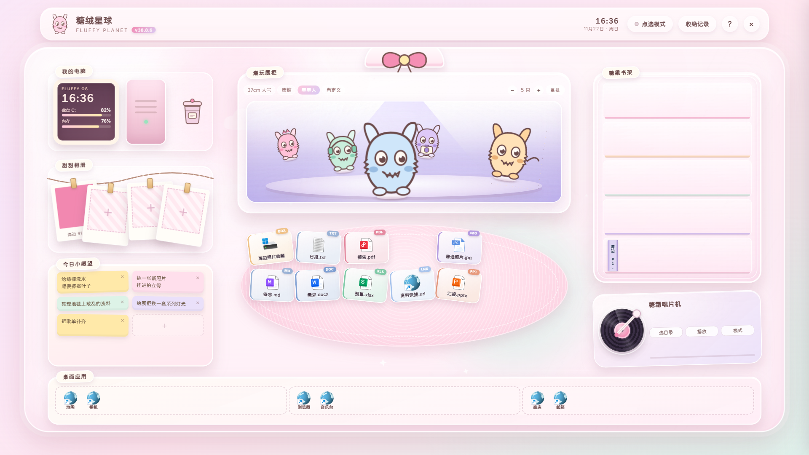
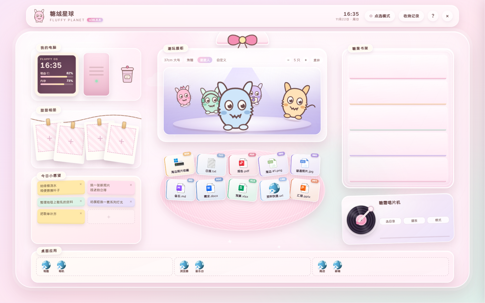
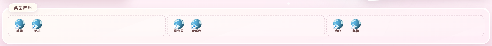
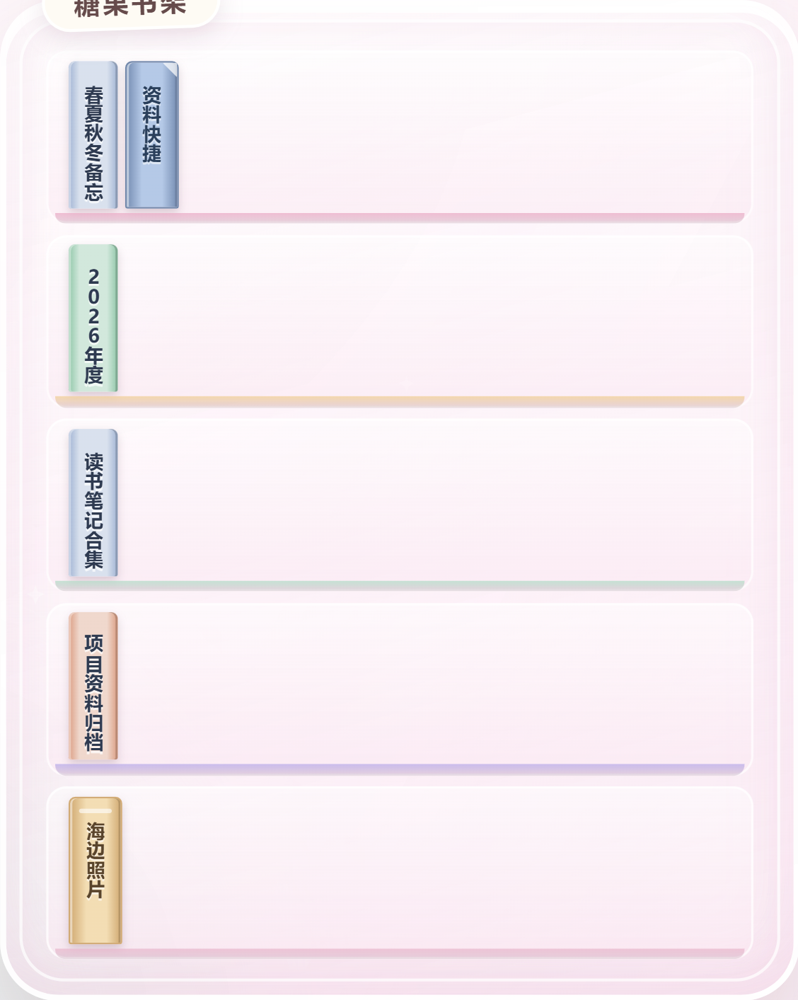
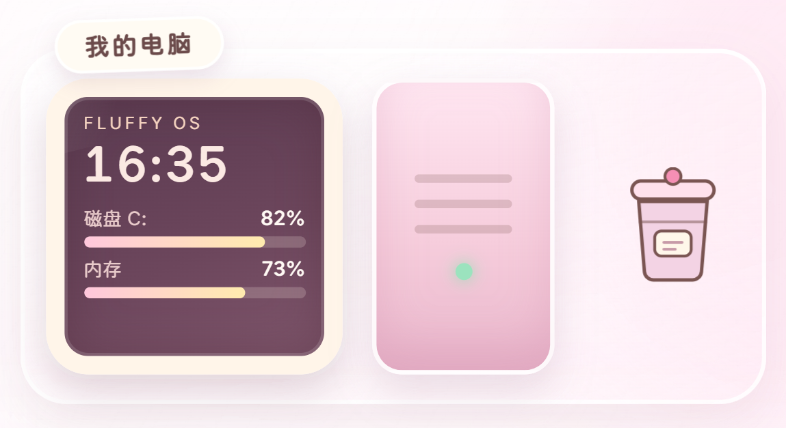

# 糖绒星球 · Desk-Fluffy-Planet

> 一块铺在 Windows 桌面层上的「玻璃收藏柜」：壁纸之上、所有应用之下，不抢焦点，空白处点击穿透给真实桌面。



把桌面上的文件、相册、待办、音乐和常用应用，收进一个粉色主题的桌面层里。

> [!WARNING]
> **本软件会真实移动你的桌面文件。** 拖上书架 = 把文件移动到 `桌面\糖绒星球书架` 目录（退出 App 时自动还原回桌面原位）。
> 首次使用前请**备份重要文件**，并先在小范围试用确认符合预期。

---

## 功能

| 模块 | 说明 |
|---|---|
| **桌面文件** | 未收纳的文件散落在地毯上，使用系统真实图标；拖到书架＝真正移动，拖出＝还原 |
| **五层糖果书架** | 资料 / 文件夹 / 快捷方式统一竖排书脊，按格式配色；支持换层、排序、批量上架 |
| **潮玩展柜** | 1–6 只站位，自由拖动、滚轮 50%–200% 缩放，PNG / GIF 原样保留 |
| **甜甜相册** | 4 张拍立得，存快照，原图被收纳后仍能显示 |
| **今日小愿望** | 双列便签，支持多行、撤销、拖进糖果罐归档 |
| **糖霜唱片机** | 本地 MP3，列表循环 / 播完即停 / 单曲循环 |
| **我的电脑** | 真实磁盘与内存读数，6 个快捷入口，双击屏保 |
| **桌面应用坞** | 自动收进 `.lnk / .url / .exe`，原图标显示，拖动换栏，右键换分栏 |
| **托盘** | 显示 / 隐藏、画面适配（自动 / 1080p / 2K / 4K）、开机自启动、退出 |

## 界面

| 主题 | 应用坞 |
|---|---|
|  |  |

| 书架书脊 | 电脑屏 |
|---|---|
|  |  |

## 系统要求

- Windows 10 / 11（64 位）
- 源码运行需要 Node.js ≥ 20
- 无需管理员权限，绿色免安装

## 下载与使用

1. 打开本仓库的 **[Releases](../../releases)** 页面，下载最新的 `糖绒星球-1.0.0-win64.zip`。
2. 解压到任意目录，双击 `糖绒星球.exe` 运行。
3. 首次运行若被 Windows SmartScreen 拦截，点「更多信息 → 仍要运行」（未签名的开源程序常见提示）。
4. 需要桌面快捷方式时，运行包内 `创建桌面快捷方式.bat`。

窗口铺满工作区、始终位于所有应用之下，被应用窗口盖住是正常的；按 `Win+D` 或最小化窗口即可看见。

## 从源码运行

```bash
npm install
npm run planet        # 或双击 启动糖绒星球.bat
```

## 打包

```bash
npm run pack:planet   # 或双击 打包糖绒星球.bat
npm run pack:source   # 生成可发布的源码包
```

产出：

| 产物 | 说明 |
|---|---|
| `release\糖绒星球 1.0.0\` | 绿色免安装文件夹（复制即用） |
| `release\糖绒星球-1.0.0-win64.zip` | 可直接分发的压缩包 |
| `release\糖绒星球-1.0.0-源码\` | 可公开发布的开源源码包 |
| `release\糖绒星球-1.0.0-源码.zip` | 源码压缩包 |

打包脚本直接复制本地 Electron 运行时并写入 exe 版本信息，完全离线。只改了前端时，把 `planet/*.js`、`planet.css`、`index.html` 复制到 `release\糖绒星球 1.0.0\resources\app\planet\` 即可。

## 数据放哪

| 路径 | 内容 |
|---|---|
| `%APPDATA%\xome-planet\` | 便签、相册快照、展柜形象、唱片机、画面档位、移动日志 |
| `桌面\糖绒星球书架\` | 书架原件。App 运行时在这里，**退出 App 自动解散回桌面原位**，下次启动再收回 |

文件始终留在桌面盘上，即使不再打开这个 App 也能直接取回。

## 验证

```bash
npm test              # 纯逻辑单测（模型 / 收纳 / 播放器 / 虚拟书架）
npm run verify:planet # CDP 端到端断言（沙箱隔离，不碰真实桌面）
npm run smoke:planet  # 打包版冒烟
```

## 目录结构

```
planet/    糖绒星球（主进程 / 渲染 / 样式 / 纯逻辑 / 字体与图标）
room/      与桌面层共用的三个模块：收纳引擎、播放状态机、窗口锚定
tools/     打包、快捷方式、图标等脚本
verify/    端到端验证与截图（沙箱隔离，不碰真实桌面）
docs/      界面截图
```

## 字体

界面内置两套开源字体，均随包分发，许可文件在 `planet/assets/fonts/`：

- **Allo**（英文 / 数字）— SIL Open Font License 1.1
- **猫啃网糖圆体**（中文）— SIL Open Font License 1.1

## 免责声明

- 本软件为个人开源项目，**仅供学习、研究与技术交流参考**，作者不提供任何商业支持、商业授权或商业担保。
- 如需将代码用于商业场景，请自行评估风险并遵守 [MIT License](LICENSE) 的约定，作者不承担因此产生的任何责任。
- 本软件会**真实移动和整理你的桌面文件**。使用前请自行备份重要数据；因误操作、强制结束进程、系统异常等导致的文件丢失或损坏，作者不承担任何责任。
- 本软件按「现状」提供，不附带任何明示或暗示的担保，包括但不限于适销性、特定用途适用性。
- 使用本软件即表示你已理解并接受上述条款；如不同意，请立即停止使用并删除。

## 参与贡献

欢迎提 Issue 或 Pull Request。提交前请先运行 `npm test` 与 `npm run verify:planet`，确保回归通过。

## License

代码以 [MIT License](LICENSE) 发布，详见 LICENSE 文件。字体遵循各自的 SIL Open Font License 1.1。
